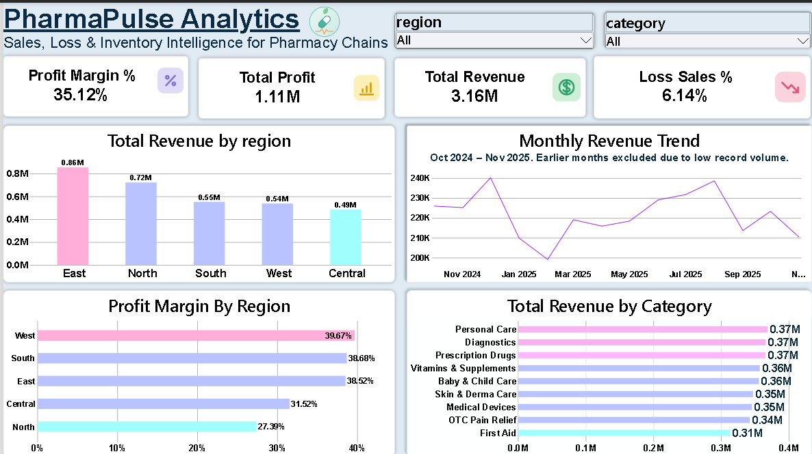

# PharmaPulse Analytics
**Sales, Loss & Inventory Intelligence for Pharmacy Chains**

An end-to-end data analysis project: raw pharmacy data (3 sales files, products, customers, stock, stores, suppliers) cleaned in **Python**, explored and validated in **SQL Server**, and presented in a 4-page **Power BI** dashboard.

## Business Problem
A pharmacy chain sells through 12 stores across 5 regions. Management wants to know:
1. Where does revenue and profit come from?
2. **Which sales lose money, and why?**
3. Which discounts and promo codes are worth it?
4. Where is inventory at risk (low stock, items close to expiry)?

## Workflow
`Raw CSV files → Python + Power Query (clean) → SQL Server (explore & validate) → Power BI (model, DAX, dashboard) → Insights`

| Step | Tool | What was done |
|---|---|---|
| Clean | Python (pandas, regex) | Merged 3 sales files with different column names and **two date formats**, removed 50 duplicate rows, cleaned prices, extracted promo codes and discount reasons from free-text notes, removed 42 duplicate customers (same phone, typo in name), calculated revenue, cost, profit, margin, `is_loss`, `discount_band` |
| Clean | Power Query (Excel) | Cleaned and shaped the other tables (products, customers, stock, prescriptions, employees, stores, suppliers, categories) inside an Excel workbook using Power Query |
| Explore | SQL Server | 22 queries: JOINs, GROUP BY, HAVING, CTEs, window functions (`LAG`, `RANK`). Also used to cross-check dashboard totals |
| Model & visualize | Power BI, DAX | Star schema, KPIs (Profit Margin %, Loss Sales %, ...), 4 report pages |

**Data quality checks:** 9,950 rows → 9,900 after de-duplication, 0 failed date conversions, 0 sales with missing customer or cost price. Totals match between Python, SQL and Power BI (Revenue 3.16M, Profit 1.11M, 608 loss sales).

## Key Insights
- **Discounts above 15% destroy margin.** Sales in the 15%+ discount band make a **21.3% margin** vs 40.9% for 0-5% discounts, and their loss rate is **9.2%** vs 4.8%. They are about 25% of all sales.
- **Vitamins & Supplements has a 22.1% loss rate**, against 2-6% for every other category. It is a pricing problem, not a discount problem: the category loses 19-21% of sales even at 0-10% discounts, and **112 of its 543 products (21%) have a cost price above the selling price**, versus about 2-4% in other categories.
- **North is the 2nd highest region by revenue (0.72M) but has the lowest margin (27.4%)**. West has the highest margin (39.7%).
- **Promo code sales earn a lower margin (31.6%) than regular sales (35.4%).** `SAVE10` is the weakest code: 28.0% margin and 9.7% loss rate.
- **About 31% of stock records are below reorder level**, and expiring items peak in September 2026.

## Recommendations
1. Cap discounts at around 15% and require approval above it.
2. Fix the selling price (or supplier cost) of the Vitamins & Supplements products that are priced below cost.
3. Review or retire the `SAVE10` promo code.
4. Investigate North's pricing and discount practice.
5. Set a clear "expiring soon" window and clear or return near-expiry stock before the monthly peaks.

   README.md                       project overview
   pharmacy_cleaning.py            Python cleaning script
   pharmacy_analysis_queries.sql   22 SQL Server queries
   PharmaPulse_PowerQuery.xlsx     Power Query cleaning (Excel)
   PharmaPulse_Dashboard.pbix      Power BI dashboard
   page1..page4 (.png)             dashboard screenshots
   *_cleaned.csv                   cleaned data (sales, products, customers)
   PharmaPulse_Analytics.pdf       presentation

## Tools
Python (pandas, numpy, regex) · Power Query (Excel) · SQL Server (SSMS) · Power BI · DAX · Excel

## Notes
- The Power BI report reads the cleaned CSV files produced by the Python script. The SQL queries run on the same cleaned data and were used for exploration and validation.
